# feetech_driver

C++ driver, Python bindings and bench tools for Feetech SMS/STS serial-bus servos (the STS3215 and related models). The library does not use ROS. It is the one implementation of the wire protocol and the serial transport, so a C++ program, a Python script and a ROS 2 hardware component send the same bytes.



| Header | Contents | Depends on |
| --- | --- | --- |
| `feetech/protocol.hpp` | Framing, sign-magnitude codec, control table, feedback block. `test/test_protocol.cpp` compares each packet with a golden byte vector | nothing |
| `feetech/bus.hpp` | Half-duplex serial transport, blocking transactions | POSIX |

The library stops at the encoder frame. A joint frame adds a sign and an offset, which are calibration and differ for each machine. The consumer owns them: [specialist_sdk](https://github.com/specialist-ai/specialist_sdk) adds the joint frame, the calibration file and the safety guards of a gripper.

## Build

```bash
pixi run build   # the library, the tests and the example
pixi run test    # the C++ tests, no hardware

uv sync          # the Python extension and the package
uv run pytest
```

The build makes a static library. Give `-DBUILD_SHARED_LIBS=ON` for a shared library, as a distribution package needs (see [One tty, one bus](#one-tty-one-bus)). A ROS 2 workspace builds this package with colcon: `package.xml` declares `<build_type>cmake</build_type>`, and the library gets no ROS dependency.

## Use

```cpp
#include "feetech/bus.hpp"

feetech::Bus bus;
if (!bus.open("/dev/ttyUSB0", 1000000)) {
  std::fprintf(stderr, "%s\n", bus.last_error().c_str());
  return 1;
}

std::vector<std::optional<feetech::Feedback>> feedback;
bus.sync_read_feedback({18, 19}, feedback);          // one transaction, both servos

std::vector<feetech::GoalEntry> goals;
goals.push_back({18, feetech::encode_goal_block(2048)});
bus.sync_write_goals(goals);                         // one broadcast frame
```

`examples/scan.cpp` uses the same API. Python uses the same core:

```python
import feetech_driver as feetech

bus = feetech.Bus()
bus.open("/dev/ttyUSB0", 1000000)
servo = feetech.Servo(bus, 18)
print(servo.feedback().position_counts)
servo.write_goal(2048)
bus.close()
```

## Tools

```bash
feetech-scan   --port /dev/ttyUSB0          # the servos that reply, and what they report
feetech-set-id --port /dev/ttyUSB0 --to 18  # give a servo its id (writes EEPROM)
```

`feetech-scan` only reads. Run it first when a bus does not work. A servo that does not reply has a power, wiring or port problem. A servo that replies at the wrong id has a provisioning problem.

`feetech-set-id` is the only part of this package that writes EEPROM. Connect one adapter at a time: two new servos both have id 1, so a write on a shared wire changes both.

Each tool stops with an error when another process holds the port. Two programs on one half-duplex bus corrupt each other's frames, and the result looks like unreliable hardware.

## Protocol

The framing is Dynamixel Protocol 1.0 (`FF FF ID LEN INST … CHK`, checksum `~sum(ID..params)`). Three details differ, and each one corrupts data without an error:

| Detail | SMS/STS | Note |
| --- | --- | --- |
| 16-bit fields | Little-endian | The older SCS series is big-endian, and most sample code does not say which series it is for |
| Signed values | Sign-magnitude | Sign bit 15 for position and velocity, 11 for the homing offset, 10 for the load. Two's-complement decoding is correct only for positive values |
| P, D, I gains | One byte each, in EEPROM | The `Lock` register protects them, so a bringup cannot write them each time. `Bus` does not clear `Lock`. `feetech-set-id` does, on request |

The register addresses agree with `SMS_STS.h` of FTServo_Linux and `feetech/tables.py` of LeRobot. We read them back from an STS3215 (model 777, firmware 3.10).

## Timing

Do not call `Bus` from a control loop. Run it on an I/O thread, and let the loop read the last sample. Measured with an STS3215 (firmware 3.10) on a CH343 adapter in `cdc_acm` mode, at 1 Mbit:

| Transaction | Median | p95 |
| --- | --- | --- |
| `SYNC_READ`, 15-byte feedback block | 1.00 ms | 1.05 ms |
| `SYNC_WRITE`, 7-byte goal block | 0.12 ms | 0.58 ms |
| Full cycle (read and write) | 1.00 ms | 1.58 ms |

Of that time, about 450 µs is on the wire. The rest is USB overhead, which each read transaction pays once for any number of servos. Thus a cycle is one `SYNC_READ` and one `SYNC_WRITE`. `sync_write_goals` is a broadcast even for one servo: no servo acknowledges it, so it costs about 1/8 of an addressed `WRITE`.

## One tty, one bus

Two devices can share one USB adapter, each on its own thread, so two `Bus` objects can open the same tty. `Bus::open` uses a registry of the process, with the resolved device path as the key. Both objects get one fd and one transaction mutex, so their threads take turns by transaction, not by byte. Because the key is the resolved path, `/dev/ttyUSB0` and a `/dev/serial/by-id` link to it are one entry. The last holder closes the fd, so when one device stops, the other continues. `test/test_bus_sharing.cpp` tests this on a pty.

**Link the library once per process.** The registry is a static, so each static copy of the library has its own registry, and the sharing fails without an error. Build a shared library where two consumers can share a process. The Python wheel uses the static library, because it is one consumer.

A registry cannot see other processes, so `open()` also takes an advisory `flock`. When another program holds the port, `open()` fails with the name of the holder:

```
'/dev/ttyUSB0' is already open by another process: ros2_control_node (pid 4213). Two programs on one half-duplex bus corrupt each other's frames. Stop the other program first.
```

`port_holders()` finds the holder: it reads the resolved target of each descriptor in `/proc`. It cannot see the processes of another user without privilege.

The lock is a `flock`, not `TIOCEXCL`. `TIOCEXCL` belongs to the tty, not to one file description, and it stays set while any descriptor of the device is open. Thus a killed driver can leave the port closed to all programs. The kernel releases a `flock` when its holder stops.

## Stable device names

The kernel gives `/dev/ttyUSB0` and `/dev/ttyACM0` in the order of enumeration. Thus two adapters can change names between boots, and a configuration can operate the wrong device. Give each adapter a udev rule that names it by its serial number, and use that name.
